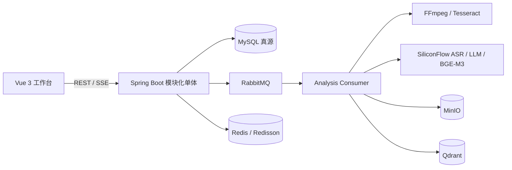

# VideoPilot

面向教学长视频的可追溯 Video Agent。用户上传本地视频后，系统通过可靠异步任务完成 ASR、OCR、关键帧、时间对齐和混合检索，并生成每条事实 Claim 都能跳回原视频时间戳的回答；证据不足时明确拒答。

V1 MVP 已完成。项目采用 Java 模块化单体和固定云端模型供应商，重点解决长任务恢复、重复投递幂等、模型调用预算、证据硬门和结果可追溯，而不是把模型输出直接当作业务事实。动态 Agent Loop 和自动目标分析已经作为默认关闭的实验能力实现；M7-M8 用户反馈与候选版本晋级闭环暂缓为 V2 Roadmap。

项目总体规划、架构边界、验收指标和逐级里程碑见 [docs/PROJECT_ROADMAP.md](docs/PROJECT_ROADMAP.md)，Redis 与参考项目的对比、当前边界及 M2-M8 演进设计见 [docs/REDIS_ARCHITECTURE.md](docs/REDIS_ARCHITECTURE.md)。
面向招聘者、演示和面试的完整说明见 [项目交付与简历面试手册](docs/PROJECT_PORTFOLIO.md)。各阶段操作细节见 [M1](docs/M1_RUNBOOK.md)、[M2](docs/M2_RUNBOOK.md)、[M3](docs/M3_RUNBOOK.md)、[M4](docs/M4_RUNBOOK.md)、[M5](docs/M5_RUNBOOK.md) 和 [M6](docs/M6_RUNBOOK.md) 运行手册。

## 当前阶段

- 正式完成：M0-M4；V1 MVP 已于 2026-11-08 退出。上传、异步解析、ASR/OCR 时间轴、混合检索、有证据问答、明确拒答、恢复/重放和可靠性仪表均可运行。
- 实验完成：M5 可复现评测流水线；M6 动态工具型 Agent、持久化 Trace、预算硬门和 READY 后自动目标分析。Agent/Worker/目标分析/前端入口均默认关闭。
- 尚未晋级：M6 DEV 三轮的严格 Claim 支撑率均值为 36.69%，引用定位率均值为 74.74%，未达到 85%/95% 原硬门，因此不宣称 Agent 效果达标。
- V2 暂缓：M7 用户反馈复核和 M8 候选版本晋级/回滚；同时暂缓多供应商路由、在线视频、完整学习管理系统、多 Agent 与公网部署。
- 验证基线：M4 冻结恢复样本 20/20；T5 最终后端 462 项快速测试、95 项集成测试，前端 125 项测试通过。完整边界见 [项目交付与简历面试手册](docs/PROJECT_PORTFOLIO.md)。
- 第一目标：可靠的视频解析与有证据问答 MVP
- 第二目标：可持久化、可预算、可评测的 Agent Loop
- 第三目标：把经过复核的用户反馈转化为 Agent 候选版本，并通过评测完成晋级或回滚

## 实施原则

1. 每个里程碑都必须形成可运行、可演示、可评测的增量。
2. MySQL 保存业务事实和恢复状态；Redis 只做缓存、锁、限流和短期去重。
3. 模型输出是候选结果，状态迁移、权限、预算、引用和证据门控由 Java 确定性代码控制。
4. 没有冻结数据集和基线，不宣称 Agent、Prompt 或检索公式带来提升。
5. 先达到当前里程碑的退出门槛，再进入下一阶段。

## 架构概览



MySQL 保存 Job、Checkpoint、Answer 和 Agent Trace；Redis 丢失后可重建。RabbitMQ 只传递标识和追踪字段，消费者通过状态、版本 CAS 和输入指纹实现至少一次投递下的幂等。模型输出必须经过 Java 确定性权限、预算、引用存在性和 Claim-Evidence 验证后才能发布。

## 本地开发

环境要求：JDK 21、Node.js 22.12+、Docker Desktop。真实凭据只能通过进程环境变量或部署平台的秘密管理注入，不能写入 Git、日志或 MQ 消息。仓库中的 `.env.example` 只有本地开发占位值；Docker Compose 会读取复制出的 `.env`，Maven 启动的 Java 进程不会自动读取它。

配置按运行环境分层：`application.yml` 只放所有环境共享的安全配置；`application-local.yml` 为本机基础设施提供开发默认值；快速测试使用隔离数据库依赖的 `test` profile；迁移集成测试使用 `integration` profile。非本地环境必须显式选择 profile 并通过环境变量提供凭据。

日志只允许记录标识符、阶段、稳定错误码和耗时。凭据、视频、完整转录、Embedding、模型 Prompt/原始响应都不能写入日志；HTTP 错误响应也只返回稳定公共文案。统一 Trace 字段为 `requestId`、`jobId`、`runId`，HTTP 使用 `X-Request-Id`、`X-Job-Id`、`X-Run-Id` 传递。

开始开发前运行工具链检查，脚本会验证 Java 21、Node.js 22.12+、Docker Compose 和 Maven Wrapper：

```powershell
powershell -ExecutionPolicy Bypass -File .\scripts\check-toolchain.ps1
```

一键启动后端和五项基础设施（首次启动或代码变更后加 `-Build`）：

```powershell
powershell -ExecutionPolicy Bypass -File .\scripts\dev-up.ps1 -Build
```

检查状态并在失败时逐项输出依赖：

```powershell
powershell -ExecutionPolicy Bypass -File .\scripts\dev-check.ps1
```

后端默认地址为 `http://localhost:8080`。若本机端口被占用，可在 `.env` 中覆盖 `SERVER_PORT` 以及依赖端口。

后端提供三类健康检查：

| 地址 | 用途 |
| --- | --- |
| `/actuator/health/liveness` | 只判断应用进程是否存活；外部依赖故障不会触发重启循环 |
| `/actuator/health/readiness` | 判断应用是否可以承接业务流量；包含五项依赖 |
| `/actuator/health/dependencies` | 分别诊断 MySQL、Redis、RabbitMQ、MinIO、Qdrant |

健康响应只公开组件名称和 `UP/DOWN`，不公开连接地址、账号、异常消息或响应正文。数据库、Redis、RabbitMQ 和 HTTP 探针均设置了有限连接/响应超时，可通过 `.env.example` 中对应变量覆盖。

启动前端（默认 `http://localhost:5173`）：

```powershell
cd client
npm ci
npm run dev
```

任务结束检查：

```powershell
cd server
.\mvnw.cmd test

cd ..\client
npm run check

cd ..
docker compose config --quiet
```

合并前安全检查使用 `powershell -ExecutionPolicy Bypass -File .\scripts\security-check.ps1`。该入口依次运行 Java OWASP Dependency-Check、npm High/Critical 审计和 Gitleaks；任一工具不可用或发现问题都会失败，不会静默跳过。

停止本地环境使用下列脚本；它不会删除命名卷，因此 MySQL、Redis、RabbitMQ、MinIO 和 Qdrant 数据会保留：

```powershell
powershell -ExecutionPolicy Bypass -File .\scripts\dev-down.ps1
```

只有明确需要清空本地数据时才使用 `docker compose down --volumes`。启动失败时先运行 `docker compose ps`，再运行 `dev-check.ps1` 查看具体依赖；容器日志可用 `docker compose logs <service>` 查询。
