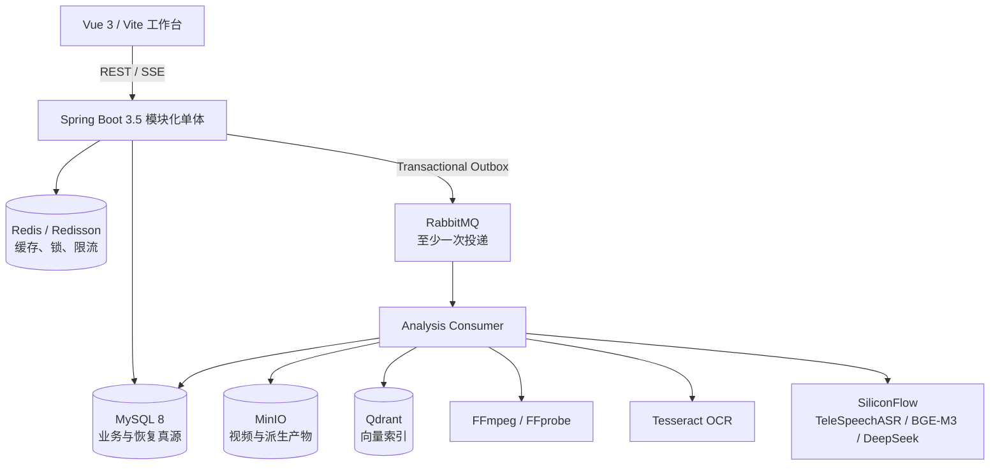
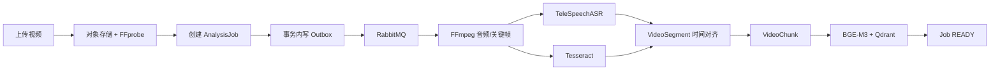
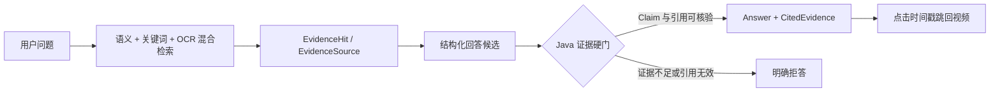

# VideoPilot 项目交付与简历面试手册

> 文档日期：2026-11-13
>
> 项目状态：V1 MVP 已完成；M5/M6 实验能力已实现但效果门未通过；M7-M8 暂缓为 V2 规划

## 1. 一句话介绍

VideoPilot 是一个面向教学长视频的可追溯 Video Agent：系统把本地视频异步转换为带时间轴的 ASR、OCR、关键帧和检索索引，再生成每条事实 Claim 都绑定原视频时间戳证据的回答；证据不足时由确定性硬门拒答。

它解决的不只是“让大模型看视频”，还包括长任务如何恢复、消息重复投递如何避免重复计费、模型结果如何验证、一次 Agent 执行如何预算和回放。

## 2. 当前完成度

| 范围 | 状态 | 已交付能力 |
| --- | --- | --- |
| M0-M4 / V1 MVP | 已完成 | 登录与资源隔离、视频上传、可靠异步解析、多模态时间轴、混合检索、证据问答、拒答、Recovery/Replay、预算与可靠性仪表 |
| M5 评测流水线 | 工程完成，效果门未退出 | 冻结数据集、DEV/TEST 隔离、生产代码离线 Runner、逐题 Trace、指标/延迟/成本报告 |
| M6 动态 Agent | 默认关闭的实验能力 | AgentRun/Step/ToolCall、动态检索/扩窗/回答/澄清/拒答、预算硬门、恢复回放、自动目标分析结果 |
| M7-M8 改进闭环 | 暂缓 | 用户反馈复核、challenge set、候选版本离线评测、晋级与回滚作为 V2 Roadmap 保留 |

“V1 MVP 已完成”与“Agent 效果已晋级”必须区分：前者已经通过 M4 可靠性发布门；后者因为 M5/M6 的回答质量指标未达到冻结硬门，仍保持关闭。

## 3. 用户可以完成什么

1. 使用本地账号登录，只访问属于自己的媒体和任务。
2. 上传本地教学视频，服务端完成对象存储和 FFprobe 校验。
3. 提交分析目标后离开页面；后台通过 Outbox 和 RabbitMQ 异步推进任务。
4. 回来查看持久化进度、失败原因、ASR/OCR/关键帧统一时间轴。
5. 围绕视频提问，获得按 Claim 组织的答案；点击 Citation 跳到原视频对应时间。
6. 当视频证据不足、依赖降级或预算不允许时，看到明确拒答或稳定错误，而不是无依据补全。
7. 在刷新页面、服务重启、Redis 丢失或 MQ 重投后继续读取同一任务事实。
8. 本地显式开启实验开关后，查看动态 Agent Trace 或 READY 后自动生成的“目标分析结果”。

## 4. 总体架构



Spring Boot 是一个部署单元，但代码按 `identity`、`media`、`analysis`、`context`、`retrieval`、`answer`、`agent`、`evaluation` 和 `infrastructure` 分域。Controller 只调用 application service，ArchUnit 防止它绕过边界直连基础设施。

### 4.1 视频分析关键链路



### 4.2 有证据问答关键链路



## 5. 关键工程设计

### 5.1 MySQL 是唯一真源

Job、Checkpoint、Answer、AgentRun 和 ToolCall 都落在 MySQL。Redis 只承担可重建的缓存、锁、限流和短期状态，因此清空 Redis 不会丢失业务事实。

### 5.2 Outbox 解决数据库与 MQ 双写

Job 状态迁移与待发布事件在同一个数据库事务中提交，再由发布器投递 RabbitMQ。RabbitMQ 采用至少一次投递；Consumer 使用数据库状态、版本 CAS、输入指纹和调用幂等键处理重复与乱序。

### 5.3 高成本阶段可恢复且不盲目重放

ASR、OCR、Embedding 和 LLM 调用均保存版本、输入指纹、状态、Token、延迟和估算成本。已完成阶段在恢复时跳过；结果不确定的高成本调用标记为 `UNKNOWN`，不会为了“跑通”而自动重放并产生重复费用。

### 5.4 模型输出只是候选数据

模型不能决定权限、任务状态或预算，也不能绕过引用规则。Java 确定性代码检查：

- 当前 owner 是否有权访问 Job、Segment 和 Answer；
- Job 是否处于允许的状态；
- Agent 的 step、deadline、Token、费用和修复次数是否超限；
- 每条事实 Claim 是否至少绑定一个真实存在且原文可核验的 `CitedEvidence`；
- 失败时是否应拒答，而不是伪造空答案。

### 5.5 Agent 是受预算的状态机，不是无限循环

M6 的 Agent 根据已持久化 Observation 选择检索、扩窗、回答、澄清或拒答。每一步和 ToolCall 都可回放，并受步骤、时间、Token、成本和答案修复次数限制。该能力默认关闭，因为工程实现完成不等于离线效果已经达到晋级门。

## 6. 可复核结果与边界

### 6.1 已通过的工程证据

- M4 冻结恢复矩阵：20/20 样本恢复成功，任务丢失 0、重复高成本调用 0、非法推进 0。
- M6-T5 后端快速门：462 项测试通过，0 failure/error；宿主机 1 项 FFmpeg 条件跳过。
- M6-T5 完整集成门：462 项快速测试、95 项集成测试通过；2 项付费/发布条件测试按设计跳过。
- 前端门：19 个测试文件、125 项测试通过；类型检查、ESLint、覆盖率和生产构建通过。
- T5 真实浏览器：历史 READY Job 补齐稳定拒答；新 Job 自动得到含 ASR/OCR 时间戳引用的目标结果；刷新恢复、引用跳转、普通历史去重、桌面和 320px 均通过。

### 6.2 不能包装成成功的结果

M6 正确策略 DEV 三轮都完成 90/90，检索指标稳定，但严格 Claim 支撑率均值只有 36.69%，引用定位率均值只有 74.74%，低于冻结的 85%/95% 硬门；首轮还有一次 BGE-M3 HTTP 400，使成本完整性为 false。因此裁决为 `M5_GATES_NOT_MET`，Agent、Worker、自动目标分析和前端实验入口继续默认关闭。

本地 OWASP Dependency-Check 因 NVD 数据不可用没有形成有效结论，不能写成扫描通过；`npm audit --audit-level=high` 无 High/Critical，但仍有 10 个 moderate。相关例外、期限和未执行项保留在 `CONSTRAINTS.md` 与各里程碑验收文档中。

### 6.3 产品边界

- 本地或单服务器部署，不宣称公网生产 SaaS。
- MVP 只支持本地视频上传，不支持在线视频抓取。
- 使用固定供应商组合，不支持多供应商动态路由。
- M7-M8 尚未实现，不宣称系统会根据用户反馈自动学习。
- 评测样本量和主题仍有限，指标代表已冻结集合，不代表所有教学视频。

## 7. 本地启动与验证

### 7.1 准备配置

需要 JDK 21、Node.js 22.12+ 和 Docker Desktop。复制本地配置后填写测试账号和需要启用的供应商凭据；不要提交 `.env`。

```powershell
Copy-Item .env.example .env
powershell -ExecutionPolicy Bypass -File .\scripts\check-toolchain.ps1
```

如需真实解析和问答，在本机 `.env` 中配置 `SILICONFLOW_API_KEY`，并按演示需要开启 ASR/OCR。Agent 相关开关默认保持 `false`，只有演示实验能力时才显式开启。

### 7.2 启动后端与基础设施

```powershell
powershell -ExecutionPolicy Bypass -File .\scripts\dev-up.ps1 -Build
powershell -ExecutionPolicy Bypass -File .\scripts\dev-check.ps1
```

后端默认地址为 `http://localhost:8080`。

### 7.3 启动前端

```powershell
cd client
npm ci
npm run dev
```

前端默认地址为 `http://localhost:5173`。

### 7.4 质量门

```powershell
cd server
.\mvnw.cmd test
.\mvnw.cmd verify -Pintegration

cd ..\client
npm run check
```

完整集成门需要健康的 Docker 依赖和隔离验证配置；真实供应商基准还需要显式凭据和对应本地 benchmark 数据。命令存在不等于已经通过，具体结果以 `tasks/M*/ACCEPTANCE.md` 为准。

## 8. 3-5 分钟演示脚本

### 0:00-0:30：说明问题

“普通视频问答容易出现两个问题：长任务中断后重做，以及答案有引用样式却无法回到真实原文。VideoPilot 用持久化任务和确定性证据门分别解决这两个问题。”

### 0:30-1:20：展示视频与异步任务

1. 登录本地工作台。
2. 展示已上传媒体和可信时长。
3. 提交一个分析目标，指出页面进度来自 MySQL 持久化事件而非前端假进度。
4. 简要展示 ASR、OCR 和关键帧统一时间轴。

### 1:20-2:30：展示核心问答闭环

1. 提交一个视频内可回答问题。
2. 展示按 Claim 分组的回答和 ASR/OCR Citation。
3. 点击引用跳到原视频时间点。
4. 再展示一个视频中没有依据的问题及明确拒答。

### 2:30-3:30：展示可靠性设计

1. 刷新页面，说明 Job、时间线和答案从 MySQL 恢复。
2. 打开可靠性区域，展示积压、失败分类、供应商调用与成本。
3. 解释 Outbox、MQ 至少一次投递、CAS 和输入指纹如何避免重复高成本调用。

### 3:30-4:30：可选 Agent 演示

1. 说明 Agent 默认关闭，只在本地实验开关开启时出现。
2. 展示目标分析结果或 Agent Trace、预算和终止原因。
3. 主动指出离线质量门未通过，所以没有把 Agent 默认上线。这比只展示“成功 Demo”更能体现工程判断。

### 4:30-5:00：收尾

“V1 已形成上传、解析、检索、证据问答和可靠恢复闭环；后续 M7-M8 会把经人工复核的真实反馈转为 challenge set，再通过离线评测决定候选版本晋级或回滚。”

## 9. 简历写法

### 9.1 一段式项目描述

独立设计并实现面向教学长视频的可追溯 Video Agent，基于 Java 21、Spring Boot、Vue 3、RabbitMQ、MySQL、MinIO 和 Qdrant 构建视频上传、异步 ASR/OCR、时间对齐、混合检索、结构化证据问答与故障恢复闭环；通过 MySQL 真源、Transactional Outbox、版本 CAS、Checkpoint 和调用指纹保证消息重投及应用重启下任务不丢失、不重复执行高成本阶段，并以 Java 确定性证据门、Agent 多维预算和版本化评测约束模型幻觉与成本。

### 9.2 可拆成简历要点

- 设计模块化单体视频分析流水线，将 FFmpeg、TeleSpeechASR、Tesseract、BGE-M3、Qdrant 与 DeepSeek 通过 Adapter 接入，形成 ASR/OCR/关键帧统一时间轴和混合检索。
- 以 MySQL 为业务与恢复真源，结合 Transactional Outbox、RabbitMQ 至少一次投递、状态版本 CAS、Checkpoint 和输入指纹，实现可恢复且幂等的长任务编排；冻结故障矩阵 20/20 恢复，任务丢失和重复高成本调用均为 0。
- 建立 `AnswerClaim -> CitedEvidence -> VideoSegment` 证据链，使用 Java 确定性代码验证引用存在性、原文绑定和权限，支持按 Claim 展示引用、时间戳跳转及证据不足拒答。
- 实现受步骤、时间、Token、费用和修复次数约束的动态 Agent Loop，持久化 AgentRun/Step/ToolCall/Observation 并支持安全恢复；因离线证据质量未达 85%/95% 硬门保持默认关闭。
- 建立冻结数据集和生产代码离线 Runner，记录模型、Prompt、Embedding、检索公式、Agent Policy、延迟与成本版本；以 DEV/TEST 隔离和确定性晋级裁决避免用演示结果替代质量结论。

如果简历空间有限，选择前三条；应聘 AI 应用/Agent 岗位时再加入后两条。

### 9.3 技术栈关键词

`Java 21`、`Spring Boot 3.5`、`Vue 3`、`MySQL 8`、`RabbitMQ`、`Redis/Redisson`、`MinIO`、`Qdrant`、`FFmpeg`、`Tesseract`、`DeepSeek`、`BGE-M3`、`Flyway`、`Docker Compose`、`SSE`、`Transactional Outbox`、`Checkpoint/Recovery`、`RAG`、`Agent Budget`。

## 10. 面试讲解框架

### 10.1 为什么不用 Redis 保存 Job 状态？

Redis 适合缓存、锁和短期状态，但任务恢复事实不能依赖它。VideoPilot 把 Job、Checkpoint、事件和调用审计放在 MySQL；Redis 清空后只会损失可重建加速数据，不会丢任务。

### 10.2 为什么需要 Outbox？

直接“先写数据库再发 MQ”或反过来都会留下中间失败窗口。Outbox 把状态变化和待发布事件放在同一事务，发布器可以重复扫描；Consumer 再通过幂等规则承受重复投递。

### 10.3 如何避免 ASR/LLM 重复计费？

每次高成本阶段都有稳定调用身份、输入指纹、Checkpoint 和持久化状态。已完成调用恢复时跳过；调用结果不确定时记录 `UNKNOWN` 并停止自动重放，由人工决定，而不是假定失败后再次付费。

### 10.4 如何降低模型幻觉？

不是只靠 Prompt。检索结果先绑定真实 Segment，模型只能返回给定 evidence ID；Java 再验证 Claim 是否有引用、引用是否属于当前 Job/owner、quote 是否能在声明时间窗原文中确定性对齐。失败就拒答，模型不能覆盖硬门。

### 10.5 Agent 和普通 RAG 有什么区别？

普通基线是固定的一次检索和一次回答。Agent 会根据 Observation 决定继续扩窗、回答、请求澄清或拒答，并把每一步持久化。但它不是无限循环，所有动作都受预算、Schema、权限和幂等约束。

### 10.6 为什么实现了 Agent 却默认关闭？

工程可运行不代表效果可发布。三轮 DEV 虽然完整执行且检索稳定，但 Claim 支撑和引用定位未达到冻结硬门。系统的确定性裁决拒绝晋级，因此保留实验入口而不默认启用。这体现的是可评测和可回滚，而不是只追求功能数量。

### 10.7 如果继续做 M7-M8，会怎样设计？

用户反馈先关联 Answer、Claim、Citation、Run 和全部版本，经过脱敏、去重和人工复核后才进入 challenge set；候选 Prompt、检索公式或 Agent Policy 只能用 dev/challenge 调整，再跑冻结回归、成本和延迟比较，通过后人工晋级，并保留上一版本快速回滚。未经复核的反馈绝不在线修改生产行为。

## 11. 后续规划

当前以项目交付、简历和演示为优先，M7-M8 暂缓，不视为 V1 缺口。

### V2：反馈改进闭环

```text
用户反馈
  -> 去敏、去重、人工复核
  -> challenge set
  -> Prompt / Retrieval / Agent Policy 候选版本
  -> 离线回放与硬门比较
  -> 人工晋级或回滚
```

恢复开发时应先做 M7 的“单条真实错误反馈 -> 复核 -> challenge set”最小纵切，再做 M8 的单候选离线比较；不先建设通用工作流平台，也不允许反馈直接改变线上 Agent。

## 12. 文档索引

- 总体范围与里程碑：[PROJECT_ROADMAP.md](PROJECT_ROADMAP.md)
- 不可降低的质量底线：[CONSTRAINTS.md](../CONSTRAINTS.md)
- M4 可靠性验收：[tasks/M4/ACCEPTANCE.md](../tasks/M4/ACCEPTANCE.md)
- M5 评测验收：[tasks/M5/ACCEPTANCE.md](../tasks/M5/ACCEPTANCE.md)
- M6 Agent 与目标分析验收：[tasks/M6/ACCEPTANCE.md](../tasks/M6/ACCEPTANCE.md)
- M1-M6 运行手册：[M1_RUNBOOK.md](M1_RUNBOOK.md)、[M2_RUNBOOK.md](M2_RUNBOOK.md)、[M3_RUNBOOK.md](M3_RUNBOOK.md)、[M4_RUNBOOK.md](M4_RUNBOOK.md)、[M5_RUNBOOK.md](M5_RUNBOOK.md)、[M6_RUNBOOK.md](M6_RUNBOOK.md)
- 架构决策：[adr/](adr/)

## 13. 交付结论

VideoPilot 当前已经满足“可运行、可演示、可解释”的 V1 MVP 定义：核心产品路径完整，可靠性机制有自动化和真实浏览器证据，实验 Agent 也有明确的默认关闭和晋级边界。现阶段继续堆叠 M7-M8 的收益低于整理演示与面试表达，因此把反馈改进闭环保留为可清楚解释的 V2 设计，是有意的范围控制，不是遗漏。
