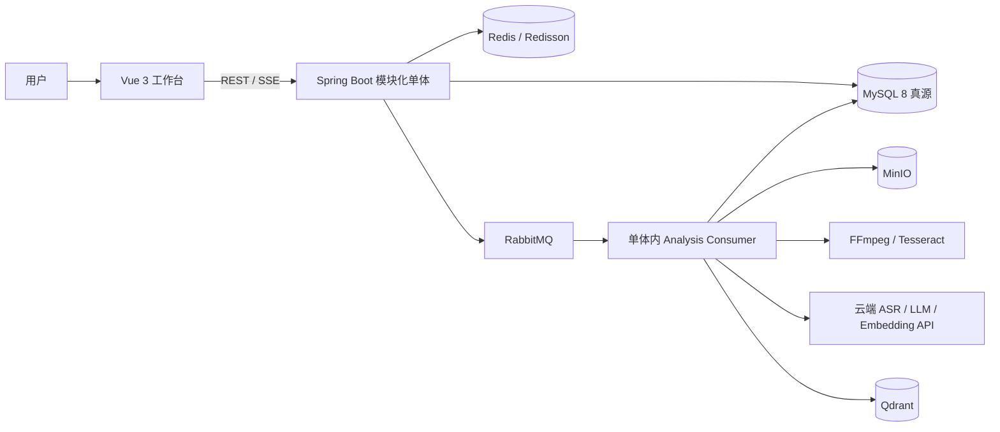
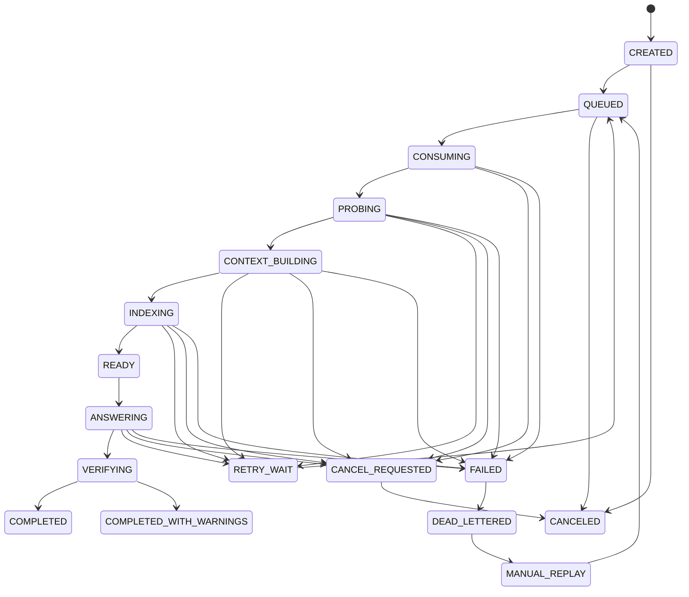
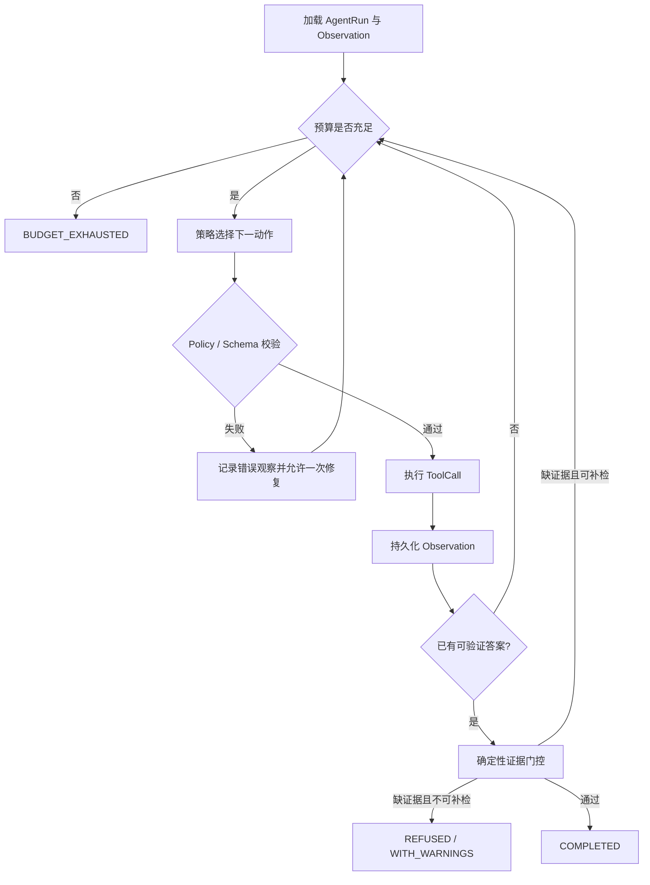
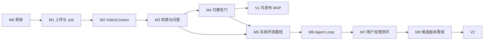

# VideoPilot 总体规划与核心里程碑

> 文档状态：Baseline v1.0
>
> 制定日期：2026-10-26
>
> 参考实现：`C:\Users\zzm\Desktop\com\DoVideoAI`
>
> 用途：作为后续架构决策、需求拆分、实现顺序和阶段验收的共同基线。

## 1. 项目定位

VideoPilot 首版聚焦教学长视频。它要把课程讲解稳定地转换为可检索、可引用、可继续追问的结构化知识，并保证任务不会因为刷新页面、服务重启、消息重投或单个云端 API 抖动而丢失或重复计费。

产品按两条主线推进：

1. **可靠产品闭环**：上传视频 -> 异步解析 -> ASR/OCR 时间对齐 -> 混合检索 -> 有时间戳的回答或拒答 -> 可恢复、可重试、可追踪。
2. **Agent 与反馈改进闭环**：Agent 根据环境观察动态选择工具 -> 验证结果 -> 必要时补检或澄清 -> 收集用户反馈 -> 复核并沉淀失败样本 -> 用冻结评测集验证候选改动 -> 晋级或回滚新版本。

第一版只服务“一个用户围绕一条教学视频进行理解、定位和问答”的核心场景，采用本地或单服务器部署，不开放公网。知识库、多 Agent 协作、自动剪辑、内容发布、支付和多租户都不进入首轮范围。

### 1.1 已确认的产品约束

| 决策项 | 已确认选择 |
| --- | --- |
| 建设方式 | 在当前目录从零新建，不迁移或直接复制 DoVideoAI 业务源码 |
| 核心内容 | 教学视频解读，优先覆盖课程、知识讲解和技术教学 |
| 首版模型 | 固定供应商和模型组合；MVP 完成后再规划多供应商切换 |
| 反馈目标 | 使用经过复核的用户反馈持续改善 Agent，而不是先建设完整学习管理系统 |
| 部署范围 | 本地或单服务器，不开放公网 |
| 视频来源 | 首版只支持本地文件上传；在线视频链接解析后置 |
| 评测数据 | 当前没有现成数据，从 M0 开始同步建设种子语料和标注规范 |
| 项目名称 | `VideoPilot` |

## 2. 不变的核心技术栈

本项目保留 DoVideoAI 的技术方向和主要版本，不以替换基础设施的方式简化问题。

| 层次 | 技术 | 项目职责 |
| --- | --- | --- |
| Web | Vue 3、Vite、SSE、Marked | 上传、视频工作台、进度、问答、证据跳转与学习面板 |
| Java 单体 | Java 21、Spring Boot 3.5.16、Undertow、MyBatis-Plus | API、任务编排、Agent、权限、状态机和评测入口 |
| 异步与协调 | RabbitMQ、Spring AMQP、Redis 7.x、Redisson | 异步任务、发布确认、消费确认、死信、去重、锁、限流和短期状态 |
| 业务与对象存储 | MySQL 8、MinIO | 业务真源、执行轨迹、Checkpoint、视频与派生产物 |
| 检索 | Qdrant、BGE-M3 Embedding | 视频片段向量索引与语义召回 |
| 视频与 AI | FFmpeg、Tesseract、LangChain4j、DeepSeek、TeleSpeechASR | 媒体处理、OCR、云端推理、ASR 与结构化输出；MVP 固定供应商 |
| 本地部署 | Docker Compose | MySQL、Redis、RabbitMQ、MinIO、Qdrant 编排 |

“Java 单体”表示一个 Spring Boot 部署单元承载 API、任务消费者、业务编排和 Agent Runtime；MySQL、Redis、RabbitMQ、MinIO、Qdrant 仍是独立基础设施。代码内部必须按领域模块隔离，不能形成一个由 Controller 直接调用几十个 Service 的大泥球。

RabbitMQ 的选择和可靠投递语义记录在 [ADR-0001：使用 RabbitMQ 承载异步任务](adr/0001-use-rabbitmq-for-analysis-jobs.md)。

## 3. 产品范围与成功定义

### 3.1 MVP 用户故事

1. 用户上传一条 30 分钟至 3 小时的视频，提交后可离开页面。
2. 用户回来后能看到真实进度、已完成阶段、失败原因和是否可重试。
3. 系统生成带时间范围的 ASR、OCR、关键帧、章节和检索片段。
4. 用户提出问题后得到结构化答案，每条事实结论可点击跳到原视频证据。
5. 视频中没有足够证据时，系统明确拒答或说明缺失信息。
6. 页面刷新、SSE 重连、后端重启、MQ 重投不会丢任务或重复执行昂贵阶段。
7. 同一视频可用不同目标反复分析，视频固有解析产物可以安全复用。

### 3.2 V1 暂缓范围

- 多资料知识库、知识图谱、团队空间和多租户；
- 自动剪辑、视频生成、社交平台发布；
- 本地 GPU 推理和独立 Python 推理服务；
- 在线视频链接解析与站点适配；
- 多云端模型供应商动态路由和自动故障切换；
- 面向公网的注册、开放访问与互联网安全运维；
- 完整的题库、掌握度、间隔复习等学习管理功能；
- 多 Agent 通信或无限自主循环；
- 自动微调生产模型；
- 根据未经核验的用户隐式行为直接修改 Prompt、检索权重或答案。

### 3.3 MVP 总体验收线

| 维度 | 最低验收线 |
| --- | --- |
| 产品闭环 | 60 分钟冻结测试视频可完成上传、解析、检索、问答和证据跳转 |
| 任务可靠性 | 故障注入测试中不丢任务；同一幂等请求不产生重复高成本调用 |
| 恢复能力 | Worker/应用在关键阶段被终止后，至少 95% 的可恢复任务自动续跑成功 |
| 引用有效性 | 至少 95% 的 `CitedEvidence` 能在声明时间窗的 ASR/OCR 原文中确定性定位 |
| 检索 | 冻结检索集 `Recall@3 >= 85%`，并同时报告 `Hit@1`、`MRR@3` |
| 回答 | 事实性 Claim 的严格证据支持率不低于 85%；不可回答题单独报告拒答正确率 |
| 可观测性 | 每个 Job、模型调用和 Tool Call 可通过 `requestId/jobId/runId` 串联 |
| 成本 | 每条任务记录 Token、调用次数、延迟和估算成本；预算超限能确定终止 |

这些是项目的首个发布门槛，不是对未来生产效果的承诺。数据集未达到规模或未人工复核时，只报告工程基线，不对外宣称质量提升。

## 4. 总体架构



建议的 Java 包边界如下。第一阶段仍使用一个 Maven 模块和一个可执行 JAR，先靠包边界、接口和 ArchUnit/约定守住模块方向；只有真实部署压力出现后再拆服务。

```text
com.videopilot
├── identity/        # 用户、鉴权、资源归属
├── media/           # 上传、MinIO、媒体探测、删除
├── analysis/        # AnalysisJob、状态机、调度、恢复、事件
├── context/         # ASR、OCR、关键帧、VideoContext
├── retrieval/       # VideoChunk、Embedding、Qdrant、混合排序
├── answer/          # 问答、Claim、Citation、拒答、验证
├── agent/           # AgentRun、ToolRegistry、策略与预算
├── feedback/        # 用户反馈、复核、失败样本和候选版本
├── evaluation/      # 数据集、Runner、指标、对比与报告
└── infrastructure/  # MQ、Redis、MySQL、MinIO、模型 Adapter
```

模块依赖遵循 `controller -> application -> domain -> port`，基础设施通过 Adapter 实现 Port。业务代码不能直接散落调用模型 SDK、Redis Key 或 Qdrant HTTP 接口。

## 5. 核心领域模型

### 5.1 身份分层

参考项目以 `mediaId + goal + mode` 充当逻辑任务身份。VideoPilot 增加独立执行身份，以解决重跑、审计、版本比较和 Agent 轨迹归属问题：

- `analysisKey = mediaFingerprint + normalizedGoal + mode + pipelineVersion`：逻辑去重与结果复用。
- `jobId`：一次可恢复的后台任务，永不复用。
- `runId`：Job 内某次 Agent 执行，重试或实验产生新 Run。
- `idempotencyKey`：客户端重复提交保护。
- `requestId`：一次 HTTP/MQ/模型调用链的追踪标识。

`analysisKey` 相同不代表永远复用旧结果。模型版本、Prompt 版本、检索版本或管线版本改变时，必须能够创建新 `jobId/runId` 并与旧版本对比。

### 5.2 关键实体

| 实体 | 关键内容 | 真源 |
| --- | --- | --- |
| `MediaAsset` | 所有者、SHA-256、MinIO key、时长、媒体状态 | MySQL |
| `AnalysisJob` | jobId、analysisKey、状态、阶段、attempt、version、错误分类 | MySQL |
| `JobStageAttempt` | 阶段输入指纹、开始/结束、重试、产物引用 | MySQL |
| `JobEvent` | 单调 sequence、阶段、消息、payload、时间 | MySQL Outbox/事件表 |
| `VideoContext` | 与目标无关的时序多模态上下文 | MySQL + MinIO 大对象 |
| `VideoSegment` | start/end、ASR、OCR、关键帧引用 | MySQL |
| `VideoChunk` | 摘要、关键词、Embedding 引用、原始 Segment | MySQL + Qdrant |
| `EvidenceHit` | 检索命中、通道、分数和时间窗 | Answer/Run trace |
| `AnswerClaim` | 可单独核验的一条事实主张 | MySQL |
| `CitedEvidence` | Claim 到原文片段与时间戳的绑定 | MySQL |
| `ModelCall` | 操作、模型、版本、Token、成本、延迟和错误 | MySQL |
| `AgentRun/AgentStep` | 目标、Observation、动作、终止原因和预算 | MySQL |
| `ToolCall` | 工具名、参数、幂等键、结果引用和耗时 | MySQL |
| `UserFeedback` | 明确反馈、原因、纠正内容、关联版本 | MySQL |
| `EvaluationRun` | 数据集版本、候选版本、逐题结果与聚合指标 | MySQL/文件产物 |

Redis 只保存 active key、限流令牌、锁、短期缓存和 SSE 热事件。Redis 内容全部丢失后，系统仍能从 MySQL 重建任务事实和恢复决策。

## 6. 可靠任务闭环

### 6.1 主状态机



状态迁移只能经过 `JobTransitionService`。每次迁移必须在同一数据库事务中完成以下动作：校验允许的前置状态和 `version`、更新 Job、写 Checkpoint/阶段产物引用、写 Outbox 事件。Controller、MQ Consumer 和定时任务都不能直接更新状态字段。

### 6.2 幂等、Checkpoint 与恢复

| 层次 | 机制 |
| --- | --- |
| 提交 | `idempotencyKey` + `analysisKey` 唯一约束；Redis active key 只做快速拦截 |
| 投递 | 数据库事务写 Job 与 Outbox；Relay 通过 Spring AMQP 投递 RabbitMQ；Publisher Confirm 成功后标记 Outbox 已发布；消息只携带 `jobId` 等定位字段 |
| 消费 | Redisson 锁 + 数据库状态/version CAS；重复消息成为 no-op |
| 阶段 | `jobId + stage + inputFingerprint` 唯一；完成产物后才推进状态 |
| 模型调用 | 先写 `ModelCall`；只对明确可重试错误有限重试；超时结果标记 `UNKNOWN` |
| 恢复 | MySQL Checkpoint 为真源；根据已完成阶段和输入指纹跳过昂贵步骤 |
| Replay | 保留与视频固有的 Context/Chunk，清除目标相关的 Plan/Answer/Critic 后新建 Run |

必须用故障注入证明这些语义：在上传合并、ASR、OCR、Embedding、Agent 首轮、结果落库前分别终止进程；恢复后检查任务数量、模型调用次数、最终产物和状态迁移是否正确。

### 6.3 外部依赖降级

| 故障 | 系统行为 |
| --- | --- |
| OCR/Tesseract 失败 | 标记视觉通道降级，保留 ASR 链路并继续 |
| ASR 永久失败 | 任务失败；不以视觉少量文本伪装完整解析 |
| Qdrant 不可用 | 使用已有 Embedding 的内存排序 + 关键词/OCR 检索 |
| Embedding 不可用 | 有限重试后退化关键词/OCR；结果标记检索降级 |
| 模式路由 LLM 失败 | 回退 `GENERAL`，不阻断主任务 |
| Critic 不可用 | 返回未验证结果或失败取决于发布策略，绝不能显示为已验证 |
| SSE 断线 | Job 继续；客户端用最后 sequence 补拉 MySQL 事件后重连 |
| RabbitMQ 重投或未确认消息重新入队 | Consumer 手动 ACK，并以数据库状态/version CAS 保证幂等，不重复烧模型费用 |

## 7. 视频理解与证据链

```text
MediaAsset
  -> FFmpeg 音频分片 + 场景关键帧
  -> TranscriptSegment + OCR/FrameObservation
  -> 时间对齐 VideoSegment（建议 60 秒）
  -> VideoChunk（建议 5 分钟索引单元）
  -> Qdrant 向量 + 关键词/OCR 混合检索
  -> EvidenceHit
  -> AnswerClaim
  -> CitedEvidence
  -> VerificationResult
```

初始检索公式沿用参考实现的方向并配置化：

```text
score = 0.60 * semantic + 0.25 * keyword + 0.15 * visual
```

权重、TopK、Query Rewrite Prompt、Embedding 模型和切片策略都必须有版本号并写入 Trace。任何调参只能使用 dev 集，test 集在版本冻结后运行一次。

回答验证包含三层：

1. **引用存在性**：片段属于当前视频，时间窗合法，引用内容能在 ASR/OCR 原文中定位。
2. **Claim 绑定**：每条事实 Claim 至少绑定一条 `CitedEvidence`，且引用指向对应 Claim。
3. **语义支持**：Critic 判断证据是否足以推出 Claim；确定性规则发现失败时，LLM 无权覆盖。

可以复用参考项目的 Citation Alignment 思路修复标点、换述或 ASR 口误造成的引用对齐问题，但搜索范围必须限制在声明时间点及相邻 Segment。全片找一句相似文本再修改时间戳，会掩盖错引。

## 8. 真正的 Agent Loop

固定执行 `Planner -> Executor -> Critic` 是有价值的 LLM 工作流，但还不足以证明 Agent 会根据环境变化决策。VideoPilot 的 Agent 必须满足以下条件：

- 下一步动作由 Goal、历史 Observation 和预算共同决定；
- 工具结果会改变下一步，例如补检、扩窗、澄清、拒答或结束；
- 每步状态持久化，服务重启后可以从最后一个安全边界恢复；
- 所有工具经过 Java Tool Registry，模型不能直接访问数据库、网络或文件；
- 有确定的步数、时间、Token、费用和修复次数上限；
- 每次结束都有明确 `terminationReason`，可离线回放。

### 8.1 初始工具集合

```text
search_transcript(query, timeRange?, topK)
search_visual_text(query, timeRange?, topK)
expand_time_window(startMs, endMs, marginMs)
get_segments(segmentIds)
draft_answer(question, evidenceIds)
verify_claims(answerDraft)
ask_user_clarification(question)
finish(reason)
```

每个 Tool 声明 JSON Schema、读写性质、超时、幂等策略、所需权限和成本等级。第一阶段工具全部只作用于当前用户和当前视频；有外部副作用的工具不进入 V2。

### 8.2 循环状态机



建议初始预算：最多 6 个 Tool Step、最多 2 次答案生成/修复、单 Run 全局 deadline、Token 上限和人民币估算成本上限。具体值通过评测标定，不能只靠配置把循环放大为无限重试。

### 8.3 Agent 晋级条件

Agent 必须与“单次检索 + 单次结构化回答”的非 Agent 基线做同题对比。满足下列任一条件才默认启用：

- 答案硬门通过率提高至少 8 个百分点，且 P95 延迟和平均成本增幅均不超过 30%；
- 在硬门通过率下降不超过 2 个百分点的情况下，P95 延迟或平均成本降低至少 20%；
- 对预先定义的复杂题子集有显著收益，且系统只对该子集路由 Agent。

否则保留为实验能力或仅在复杂问题中按规则启用。

## 9. 用户反馈驱动的 Agent 改进闭环

首版“学习反馈”指系统从用户反馈中学习如何改进 Agent，而不是先建设面向学生的题库、掌握度和间隔复习产品。练习与个性化学习可在 V2 闭环稳定后作为独立版本规划。

```text
显式反馈/失败样本
  -> 去敏与去重
  -> 人工复核或规则裁决
  -> 加入 dev/challenge 数据集
  -> 形成 Prompt/检索/策略候选版本
  -> 离线回放与成本评测
  -> 达到门槛后灰度
  -> 线上监测
  -> 晋级或回滚
```

### 9.1 反馈信号分级

| 信号 | 例子 | 能否直接成为质量标签 |
| --- | --- | --- |
| 强显式 | 用户指出错误 Claim、提供纠正答案、标记错引 | 复核后可以 |
| 弱显式 | 点赞/点踩、选择“没回答问题” | 只能生成待复核样本 |
| 隐式 | 点击引用、跳转播放、重新提问、停止观看 | 只能用于产品分析，不能视为事实真值 |
| 系统 | 引用校验失败、预算耗尽、Tool Schema 错误 | 可直接成为工程质量标签 |

系统不在生产请求中在线修改 Prompt 或权重。所有“学习”都通过版本化候选、冻结评测和晋级门完成，确保结果可解释、可回滚。

### 9.2 反馈对象

每条 `UserFeedback` 至少关联 `answerId`、`runId`、Agent/Prompt/检索版本、反馈类型和创建时间。支持以下首版反馈：

- 整体回答有用或无用；
- 指定 Claim 错误、缺失或偏离问题；
- 指定 Citation 错引、证据不足或时间点不准确；
- 用户给出纠正文本或期望回答；
- 系统自动记录引用校验失败、错误拒答、预算耗尽和无效 Tool Call。

原始反馈是不可直接信任的输入。进入评测集前必须经过去敏、去重和复核，并保留“接受、驳回、待确认”的裁决状态及理由。

### 9.3 候选版本晋级

一次 Agent 改进必须表示为可追踪的候选版本，例如 `promptVersion`、`retrievalVersion`、`agentPolicyVersion` 或确定性规则版本。候选版本只能使用 dev/challenge 数据调试；通过回归硬门后才能在本地或单服务器环境手动启用。任何晋级都保留上一稳定版本，以便立即回滚。

## 10. 评测体系

评测不是最后补脚本，而是每个里程碑的交付物。目录建议：

```text
benchmark/
├── datasets/
│   ├── retrieval/
│   ├── answer/
│   ├── agent/
│   └── feedback/
├── runners/             # 调用生产 Java 代码的评测入口
├── reports/             # 可提交的聚合结果和逐题摘要
├── local/               # 原视频、完整 ASR/OCR、Embedding，不入 Git
└── README.md             # 口径、数据版本、复现命令和限制
```

### 10.1 分层指标

| 层级 | 核心指标 |
| --- | --- |
| 媒体解析 | ASR/OCR 成功率、时间戳覆盖、空片段率、处理实时倍率、单小时视频成本 |
| 检索 | Recall@K、Hit@1、MRR、视觉题/模糊题/精确题分组结果 |
| 回答 | 正确性、完整性、严格 Claim-Evidence 支持率、引用位置、拒答准确率 |
| Agent | 任务成功率、首轮/补检恢复率、无效 Tool 比例、平均步数、终止原因分布 |
| 反馈闭环 | 有效反馈率、复核一致率、失败类型覆盖率、候选修复率、回归失败率 |
| 可靠性 | 丢任务率、重复执行率、恢复成功率、非法状态迁移、DLQ/Replay 成功率 |
| 性能成本 | P50/P95 延迟、Token、模型调用数、每任务成本、线程池/连接池饱和度 |

### 10.2 数据集建设计划

当前没有可直接使用的评测数据，因此评测语料建设与产品实现并行推进：

1. M0 确定教学视频选择标准、版权/使用边界、标注 Schema 和文件组织。
2. M1-M2 选取第一条 45-90 分钟教学视频，随解析管线产出完整 ASR/OCR 和时间轴。
3. M3 前完成人工种子集，用于验证检索和证据问答；未完成种子集时不得用主观 Demo 代替质量验收。
4. M5 扩展并冻结发布集，建立 dev/test 隔离和逐题复核记录。

- 起步集：至少 3 条不同主题的教学视频，每条 45-90 分钟，合计 60 道检索题和 30 道答案题。
- 发布集：至少 5 条教学视频、120 道检索题；精确、模糊、视觉/OCR 约为 40%/40%/20%。
- 答案集必须同时包含可回答和不可回答题，并标注必需事实、禁止断言、相关时间窗和证据通道。
- dev/test 按视频或主题隔离；调 Prompt、权重和阈值只看 dev，冻结后再运行 test。
- 自动生成的问题必须人工核对后才能进入正式集合。
- LLM-as-Judge 只作为辅助；硬门由确定性校验和抽样人工复核共同确认。
- 每次报告保存数据集、模型、Prompt、检索公式、代码提交和配置指纹。

## 11. 核心里程碑

时间是单人全职开发的粗略估算。实际推进以“退出门槛”作为完成标准，不以自然周结束为完成标准。

### M0：工程骨架与契约冻结（3-5 天）

交付：

- 初始化 Java 21/Spring Boot、Vue 3、Docker Compose 和 CI；
- 建立上述领域包边界、统一错误结构和配置分层；
- 建立 Flyway、日志 Trace、秘密配置和本地一键启动；
- 写出 Job 身份、状态机、Checkpoint、Outbox 和错误分类 ADR；
- 建立 `benchmark/` 目录、教学视频筛选规范、标注 Schema 和数据版本规范；
- 建立供应商配置清单，MVP 固定 LLM、ASR、Embedding 和 OCR 方案，同时保留 Adapter 边界。

退出门槛：空业务环境能一键启动；Health 能区分应用存活与五项基础设施健康；CI 完成编译、单测和迁移校验；任何密钥均未进入仓库；评测标注模板可以容纳问题、相关时间窗、证据通道、必需事实和禁止断言。

### M1：上传与异步 Job 最小闭环（1-2 周）

交付：

- 登录/资源归属、MinIO 上传、媒体元数据和 FFprobe 校验；
- `AnalysisJob`、JobEvent、统一状态迁移、Outbox -> RabbitMQ -> Consumer；
- SSE 进度、刷新后补拉、取消和失败展示；
- Redis active key、数据库幂等约束和 Redisson 消费锁。

退出门槛：重复提交只创建一个逻辑执行；MQ 消息重复投递不重复推进；重启应用后 Job 仍能从 MySQL 找回；其他用户不能读取视频或 Job。

### M2：时序多模态 VideoContext（1-2 周）

交付：

- FFmpeg 音频切片、场景关键帧和保底采样；
- TeleSpeechASR、Tesseract/OCR Adapter、独立有界线程池；
- `TranscriptSegment -> VideoSegment -> VideoContext` 对齐与持久化；
- ASR/OCR 超时、有限重试、降级、子进程清理和阶段 Checkpoint。

退出门槛：首条选定的 45-90 分钟教学视频可生成完整时间轴；OCR 失败时 ASR 结果仍可用；ASR 阶段中断重启后不重做已完成切片；每个外部调用有成本和错误记录。

### M3：混合检索与有证据问答（1-2 周）

交付：

- 5 分钟 VideoChunk、摘要/关键词、BGE-M3 Embedding 和 Qdrant 索引；
- 语义 + 关键词 + OCR 混合排序和降级检索；
- 结构化 `AnswerClaim/CitedEvidence`、时间戳跳转、拒答；
- 确定性引用验证和受限 Citation Alignment。

退出门槛：端到端产品闭环可演示；每条事实 Claim 有可点击证据；伪造引用被硬门拦截；Qdrant 不可用时任务可降级完成；完成至少 1 条教学视频的人工种子标注并报告检索基线。`Recall@3 >= 80%` 作为进入扩样阶段的目标，不在样本不足时包装成正式结论。

### M4：任务可靠性发布门（1-2 周）

交付：

- 完整 Checkpoint/Recovery、Retry/DLQ/Manual Replay；
- 全链路 deadline、Token/成本预算、限流和资源池隔离；
- 故障注入测试、并发重复提交测试和 SSE 重连测试；
- 运维仪表：积压、失败分类、阶段耗时、供应商错误和成本。

退出门槛：故障注入中无任务丢失、无重复高成本阶段；恢复成功率达到 95%；所有非法状态迁移被拒绝；可重试与不可重试错误具有稳定语义。至此形成 V1 MVP。

### M5：建设数据集、冻结基线与评测流水线（1-2 周）

交付：

- 从零扩展至发布规模的检索、答案、拒答和可靠性数据集；
- Java 生产代码离线 Runner、逐题 Trace 和可复现报告；
- 非 Agent 基线：一次混合检索 + 一次结构化回答 + 确定性验证；
- Prompt、模型、Embedding、公式、阈值和代码版本固化。

退出门槛：同一配置可重复生成一致的确定性指标；随机性指标报告均值/方差；test 集未参与调参；人工抽检完成。没有这一门槛，不进入 Agent 效果宣称。

### M6：动态工具型 Agent Loop（2 周）

交付：

- `AgentRun/AgentStep/ToolCall/Observation` 持久化；
- Tool Registry、Schema、Policy、幂等、权限和成本等级；
- 基于 Observation 的动作选择、补检/扩窗/澄清/拒答/结束；
- 全局预算、最多步骤、答案修复上限、恢复和轨迹回放；
- Agent 与 M5 非 Agent 基线的同题 A/B。

退出门槛：至少存在三类因工具结果不同而产生的不同执行路径；重启能从安全 Step 恢复；越权 Tool 和超预算调用被拒绝；达到第 8.3 节至少一条晋级条件。

### M7：用户反馈采集与复核闭环（1-2 周）

交付：

- 回答、Claim 和 Citation 三级显式反馈；
- 错误类型、纠正文本、运行版本和 Trace 自动关联；
- 反馈去敏、去重、复核队列、裁决状态和审计记录；
- 将通过复核的失败样本加入 dev/challenge 数据集。

退出门槛：一条真实错误回答能完成“用户反馈 -> 关联 Run/版本 -> 复核 -> 进入 challenge set”的完整演示；未经复核的反馈不会直接改变 Agent 行为。

### M8：Agent 候选版本评测与晋级（1-2 周）

交付：

- 从 challenge set 聚类失败类型并选择可解释的修复目标；
- 注册 Prompt、检索、Agent Policy 或确定性规则候选版本；
- 对候选版本执行离线回放、硬门回归和成本比较；
- 在本地/单服务器环境手动启用候选版本并支持快速回滚。

退出门槛：能从一条经过复核的真实失败样本生成候选改动，跑完整评测，展示指标与成本差异，并在不修改历史记录的前提下晋级或回滚版本。至此形成 V2 闭环。

## 12. 里程碑依赖与推荐发布点



推荐设置三个演示检查点：

1. **M2 后**：上传视频，展示可恢复的 ASR/OCR 时间轴。
2. **M4 后**：展示带引用问答、拒答、服务重启恢复和 MQ 重投幂等。
3. **M8 后**：展示 Agent 动态补检，以及一条用户反馈如何经过复核、候选修复、离线评测和版本回滚形成闭环。

## 13. 开发纪律与决策原则

- 每个里程碑先写验收场景和最小失败复现，再实现业务代码。
- 修改状态机、任务身份、Agent 预算、证据门或反馈晋级规则时必须新增 ADR。
- 数据库迁移只前进，不依赖手工改表；Checkpoint payload 必须带 schemaVersion。
- 云端模型调用统一经过 Adapter；业务层不出现供应商专属响应类型。
- Prompt、检索公式、Embedding 模型和 Agent Policy 都是版本化生产资产。
- 可观测 Trace 不能存 API Key、完整密码或不必要的用户隐私。
- 优先复用视频固有产物，禁止因不同问题重复执行 ASR/OCR。
- 单元测试保护纯规则，集成测试保护数据库/MQ/对象存储边界，故障注入保护恢复语义；不要用大量 mock 测试替代真实边界验证。

## 14. 主要风险与控制措施

| 风险 | 控制措施 |
| --- | --- |
| 一开始照搬参考项目全部复杂度 | 按 M0-M8 垂直切片建设，每阶段只引入当前验收所需能力 |
| Java 单体内部耦合失控 | 领域包边界、Port/Adapter、禁止跨模块直接访问 Mapper |
| MQ/Redis 与 MySQL 状态不一致 | MySQL 真源、事务 Outbox、版本 CAS、Redis 可重建 |
| 模型超时导致重复费用 | ModelCall 状态、调用指纹、有限重试、UNKNOWN 语义和预算 |
| Agent 只是多次 Prompt 包装 | 要求动态工具选择、Observation 改变路径、轨迹回放和基线 A/B |
| 用户反馈污染系统 | 强弱信号分级、人工/规则复核、离线晋级、禁止在线自改 |
| LLM Judge 自我偏好 | 确定性硬门、独立模型复核、人工抽样并报告限制 |
| 指标被短视频或数据泄漏抬高 | 使用长视频、按视频拆分 dev/test、冻结 test、报告分组指标 |
| OCR/ASR 单点失败 | 独立线程池、分片 Checkpoint、单分支降级和错误分类 |
| 成本随 Agent 循环失控 | 步数/时间/Token/金额四重预算和复杂问题条件路由 |

## 15. 下一步启动顺序

后续真正开始构建时，严格按以下顺序进入 M0：

1. 在已更名的 `E:\VideoPilot` 工作区初始化 Maven/Vue 工程和 Compose；不复制参考项目的业务源码。
2. 先提交 4 份 ADR：任务身份、状态机、Outbox/Checkpoint、云端模型调用与预算。
3. 建立最小 MySQL 表：`media_asset`、`analysis_job`、`job_stage_attempt`、`job_event_outbox`、`model_call`。
4. 实现一条不调用模型的假任务链，验证提交、MQ、状态迁移、SSE、重启和幂等。
5. 假任务可靠后再接入 MinIO/FFmpeg 和云端 ASR；不要把任务可靠性问题与模型效果问题同时调试。

这份规划是后续里程碑拆解的上层基线。每开始一个里程碑，应另建该阶段的实施清单，列出数据库迁移、API、领域接口、测试、评测数据和退出证据；完成后把实际指标回填到本文件，而不是只把任务标记为“完成”。
